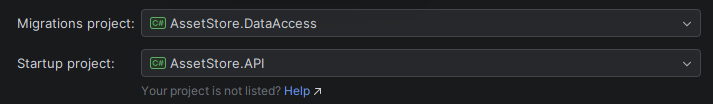

# Asset-store

Game assets store. Backend via ASP.NET.

### How to start
To start - you need to set up postgresql in Docker:
```cmd
> cd .\AssetStore.API\
> docker-compose up -d
```
Create initial migration
